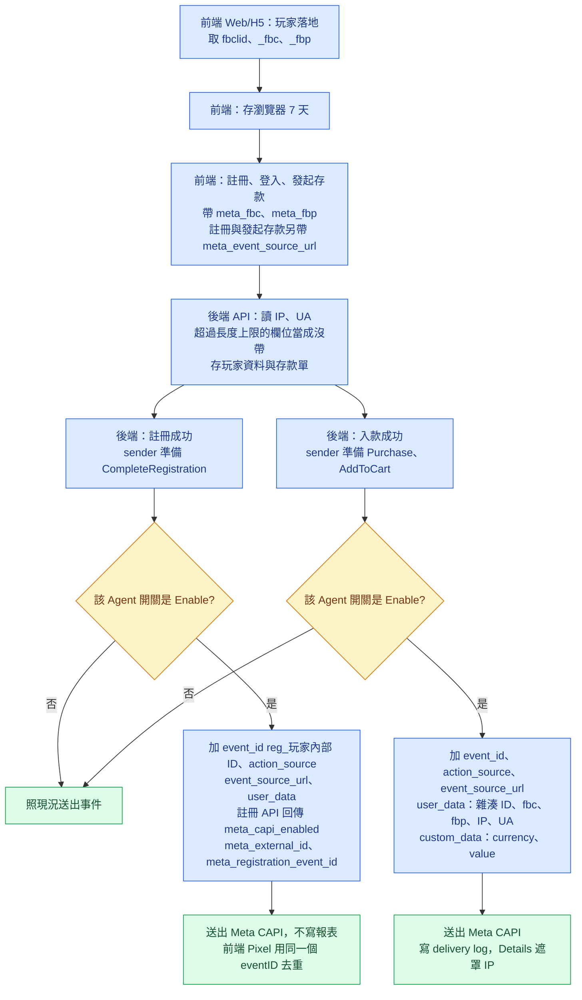

# PRD：Meta CAPI 事件加帶比對參數（BA032）

**版本**：v1.1（2026-10-27）　**類型**：功能變更　**負責**：PM
**Mockup**：[mockup](https://guswei.github.io/betally-bo-mockup/meta-capi-match-params/mockup.html)
**相關**：[RD Spec](https://github.com/guswei/betally-bo-mockup/blob/main/meta-capi-match-params/meta_capi_match_params_spec.md)

## 1. 需求背景

BA032 的 Meta `Purchase` 事件，Events Manager 收到的筆數與 BO 紀錄一致，Ads Manager 卻幾乎歸因不到廣告。原因是後端送出的事件沒有任何比對用欄位，Meta 無法把事件對回點過廣告的人。客戶要求事件帶上 `fbc`、`fbp`、`external_id`。

本案由前台在玩家落地時取得比對參數，後端保存後在送出事件時帶上。改動以 Admin BO 的 Agent 層級開關控制，上線時只對 BA032 開啟。只處理 Web／H5，不處理 App。

## 2. 核心功能變更

| # | 變更 (FR) | 說明 | 負責端 |
|---|---|---|---|
| FR-1 | Agent 層級開關 | Admin BO 新增 `Meta CAPI Customer Matching`，值 `Enable`／`Deny`，預設 `Deny` | 後端（API） |
| FR-2 | 前台取得比對參數 | 落地時取得 `fbc`、`fbp`，存在瀏覽器 7 天；註冊、登入、發起存款時帶給後端 | 前端（Web/H5） |
| FR-3 | 後端保存比對參數 | 註冊與登入時更新玩家資料；發起存款時記在存款單；IP 與 UA 由後端讀 request | 後端（API） |
| FR-4 | `Purchase`、`AddToCart` 加欄位 | 開關 `Enable` 時加 `event_id`、`action_source`、`event_source_url`、`user_data`、`custom_data.currency`／`value` | 後端（API） |
| FR-5 | `CompleteRegistration` 加欄位 | 開關 `Enable` 時，註冊成功送出的事件加 `event_id`、`action_source`、`event_source_url`、`user_data`；不加 `custom_data` | 後端（API） |
| FR-6 | Pixel 帶 `external_id` | 開關 `Enable` 且玩家已登入時，Pixel 帶後端回傳的雜湊 ID；註冊成功時，Pixel 先帶註冊 API 回傳的雜湊 ID，再把註冊 API 回傳的 `meta_registration_event_id` 帶入 Pixel `CompleteRegistration` 的 `eventID` 去重 | 前端（Web/H5） |
| FR-7 | 報表 Details 顯示新欄位 | `Marketing Event Delivery Report` 的 Details 顯示新欄位，`client_ip_address` 遮罩為 `***` | 後端（API） |
| FR-8 | 轉址保留 `fbclid` | PWA `cin4.xyz` → tracker link → `gol7392.com` 每一次轉址都保留 `fbclid` | 待技術主管指派 |

範圍：Admin BO Agent 設定、Web／H5 前台、註冊／登入／存款 API、Meta sender、`Marketing Event Delivery Report` 的 Details。OUT：App 事件、`em`／`ph`、移除明文 `Username`、補送舊事件、Adjust 與 CleverTap、Meta 後台設定、Ads Manager 歸因成效。

## 3. 介面設計

以 Mockup 為準：https://guswei.github.io/betally-bo-mockup/meta-capi-match-params/mockup.html 。重點：

- Admin BO `Agent Accounts` › `Edit` › `System Config` 新增 `Meta CAPI Customer Matching` 下拉，選項 `Enable`、`Deny`，預設 `Deny`。
- 站點的 Agent BO 看不到這個開關。
- `Marketing Event Delivery Report` 的 Details 在 request properties 顯示新欄位。
- Details 中 `external_id` 顯示雜湊值，`client_ip_address` 顯示 `***`。
- 前台沒有畫面變更。

**BO 欄位表**：

| 欄位 | 型別/精度 | 必填 | 說明 / enum / 邊界 |
|---|---|---|---|
| `Meta CAPI Customer Matching` | enum | 是 | `Enable`、`Deny`，預設 `Deny`。每個 Agent 各自設定 |
| `meta_fbc`（request） | `VARCHAR(500)` | 否 | 註冊、登入、發起存款帶。超過 500 字時，後端當成沒帶。超過 500 字時，後端不保存該值。超過 500 字時，sender 不使用該值。超過 500 字時，後端照常處理請求 |
| `meta_fbp`（request） | `VARCHAR(255)` | 否 | 註冊、登入、發起存款帶。超過 255 字時，後端當成沒帶。超過 255 字時，後端不保存該值。超過 255 字時，sender 不使用該值。超過 255 字時，後端照常處理請求 |
| `meta_event_source_url`（request） | `VARCHAR(2048)` | 否 | 註冊、發起存款帶。超過 2048 字時，後端當成沒帶。超過 2048 字時，後端不保存該值。超過 2048 字時，sender 不使用該值。超過 2048 字時，後端照常處理請求 |
| `meta_capi_enabled`（response） | boolean | 是 | 玩家所屬 Agent 的開關為 `Enable` 時為 `true`，`Deny` 時為 `false`。玩家資料 API、登入 API、註冊 API 回傳 |
| `meta_external_id`（response） | string | 否 | 玩家資料 API、登入 API、註冊 API 回傳雜湊 ID。開關 `Deny` 時不回傳 |
| `meta_registration_event_id`（response） | string | 否 | 註冊成功回傳 `reg_<玩家內部 ID>`。開關 `Deny` 時不回傳 |

## 4. 資料模型

| Table | 欄位 | 型別 | 約束 |
|---|---|---|---|
| Agent 設定 | 開關 | enum `Enable`／`Deny` | `NOT NULL`，預設 `Deny` |
| 玩家資料 | `fbc` | `VARCHAR(500)` | 可為 NULL |
| 玩家資料 | `fbp` | `VARCHAR(255)` | 可為 NULL |
| 玩家資料 | `client_ip_address` | `VARCHAR(45)` | 可為 NULL |
| 玩家資料 | `client_user_agent` | `TEXT` | 可為 NULL |
| 存款單 | `fbc` | `VARCHAR(500)` | 可為 NULL |
| 存款單 | `fbp` | `VARCHAR(255)` | 可為 NULL |
| 存款單 | `client_ip_address` | `VARCHAR(45)` | 可為 NULL |
| 存款單 | `client_user_agent` | `TEXT` | 可為 NULL |
| 存款單 | `event_source_url` | `VARCHAR(2048)` | 可為 NULL |

欄位名稱由後端 RD 依既有命名決定；型別照上表。

既有存款金額欄位維持 `DECIMAL(18,2)`。`custom_data.value` 由該欄位轉成 JSON 數字，不經 float。

## 5. 流程圖

## 6. 選單位置

沿用現有，無新增選單項。

| 選單路徑 | 角色 / 權限 | 說明 |
|---|---|---|
| Admin BO `Agent Accounts` › `Edit` › `System Config` | 沿用該頁既有的編輯權限 | 新增 `Meta CAPI Customer Matching` 設定 |
| Agent BO 任何頁面 | 四層 Agent 帳號一律不可見、不可改 | Agent BO 不顯示此開關。Agent BO 帳號直接呼叫設定 API 修改此開關時，後端不接受 |
| `Marketing Event Delivery Report` › Details | 沿用既有報表權限 | 只多顯示新欄位，權限不變 |

## 7. 驗收標準（AC）

| AC-ID | 對應 FR | 驗收條件 |
|---|---|---|
| AC-01 | FR-1 | 新建 Agent 的 `Meta CAPI Customer Matching` 預設為 `Deny`。 |
| AC-02（負向） | FR-1 | Agent BO 的任何頁面**不得**出現 `Meta CAPI Customer Matching`。 |
| AC-03 | FR-2 | 瀏覽器沒有已保存的 `fbc`，玩家以帶 `fbclid=AbC1` 的網址落地時，`meta_match` 的 `fbc` 為 `fb.1.<落地毫秒>.AbC1`。 |
| AC-04 | FR-2 | 承 AC-03，`ts` 距今小於或等於 604,800,000 毫秒時，玩家以同一網址重新整理頁面，`fbc` 的值與 `ts` 都不變。 |
| AC-05 | FR-2 | 網址沒有 `fbclid`、沒有已保存的 `fbc`，且有 `_fbc` cookie 時，`meta_match` 的 `fbc` 為該 cookie 的值。 |
| AC-06（負向） | FR-2 | 網址沒有 `fbclid`、沒有 `_fbc` cookie，且已保存 `fbc` 的 `ts` 距今大於 604,800,000 毫秒時，前端**不得**在 request 帶 `meta_fbc`。 |
| AC-07 | FR-2 | `meta_match` 有未過期的 `fbc`、`fbp` 時，註冊與發起存款的 request 帶 `meta_fbc`、`meta_fbp`、`meta_event_source_url`。 |
| AC-08（負向） | FR-2 | `meta_match` 沒有某個參數時，前端**不得**在 request 送該欄位的空字串。 |
| AC-09 | FR-3 | 發起存款後，存款單記下 request 的 `meta_fbc`、`meta_fbp`、`meta_event_source_url`，以及後端讀到的 IP 與 UA。 |
| AC-10 | FR-3 | 登入 request 沒有 `meta_fbc` 時，玩家資料保留原本的 `fbc`。 |
| AC-11（負向） | FR-3 | 發起存款的 `meta_fbc` 為 501 字時，後端**不得**保存該值。 |
| AC-12 | FR-4 | 開關 `Enable` 時，首次入款成功送出的 `Purchase` 帶 `event_id = ftd_<存款單號>` 與 `action_source = website`。 |
| AC-13 | FR-4 | 開關 `Enable` 時，入款成功送出的 `AddToCart` 帶 `event_id = dep_<存款單號>` 與 `action_source = website`。 |
| AC-14 | FR-4 | 開關 `Enable` 時，`user_data.external_id` 等於玩家內部 ID 的 SHA-256 小寫 16 進位字串。 |
| AC-15 | FR-4 | 開關 `Enable`、存款單沒有 `fbc` 而玩家資料有時，`Purchase` 的 `user_data.fbc` 為玩家資料的值。 |
| AC-16（負向） | FR-4 | `fbc`、`fbp`、`client_ip_address`、`client_user_agent` **不得**雜湊。 |
| AC-17 | FR-4 | 開關 `Enable` 時，`custom_data.currency` 為存款幣別，`custom_data.value` 為入款金額的 JSON 數字。 |
| AC-18（負向） | FR-4 | 開關 `Enable` 且入款金額為 `9999999999999999.99` 時，原始 JSON 的 `custom_data.value` 以十進位解析後等於 `9999999999999999.99`。核對過程**不得**使用 float。 |
| AC-19 | FR-4 | 開關 `Enable` 時，既有自訂參數 `Username`、`Amount`、`Currency`、`Date` 仍照現況送出。 |
| AC-20（負向） | FR-4 | 開關 `Deny` 時，送出的事件**不得**與上線前的 payload 有任何差異。 |
| AC-21 | FR-4 | 存款單與玩家資料都沒有 `fbc` 時，事件照常送出，payload 不含 `user_data.fbc`。 |
| AC-22 | FR-5 | 開關 `Enable` 時，註冊成功送出的 `CompleteRegistration` 帶 `event_id = reg_<玩家內部 ID>` 與雜湊 ID。 |
| AC-23（負向） | FR-5 | `CompleteRegistration` **不得**寫進 `Marketing Event Delivery Report`。 |
| AC-24 | FR-6 | 開關 `Enable` 且玩家已登入時，Pixel 的 `external_id` 等於玩家資料 API 回傳的 `meta_external_id`。 |
| AC-25（負向） | FR-6 | 玩家未登入或開關 `Deny` 時，Pixel **不得**帶 `external_id`。 |
| AC-26 | FR-6 | 開關 `Enable` 時，註冊成功送出的 Pixel `CompleteRegistration`，`eventID` 等於後端事件的 `event_id`。 |
| AC-27 | FR-7 | 開關 `Enable` 的 Agent，Details 的 request properties 顯示該事件送出的 `event_id`、`action_source`、`event_source_url`、`external_id`、`fbc`、`fbp`、`client_user_agent`、`currency`、`value`。 |
| AC-28（負向） | FR-7 | Details 的 `client_ip_address` **不得**顯示原值，一律顯示 `***`。 |
| AC-29 | FR-8 | 以 `cin4.xyz?fbclid=AbC1` 進入並經 tracker link 轉址後，`gol7392.com` 的網址帶 `fbclid=AbC1`。 |
| AC-30（負向） | FR-1 | Agent BO 帳號直接呼叫設定 API 修改開關時，後端**不得**改變開關的值。 |
| AC-31（負向） | FR-2 | 已保存 `fbc` 為 `fb.1.5000.NewB` 且 `ts` 未超過 7 天、`_fbc` cookie 為 `fb.1.2000.OldA` 時，前端**不得**把 `fbc` 改成 cookie 的值。 |
| AC-32（負向） | FR-2 | 網址為 `?fbclid=`（空字串）時，前端**不得**把 `fbc` 設為以 `fb.1.<毫秒>.` 結尾、沒有 `fbclid` 的值。 |
| AC-33（負向） | FR-2 | 頁面載入時 `ts` 未滿 7 天、發起存款時已超過 7 天且 cookie 沒有值的參數，前端**不得**帶進 request。 |
| AC-34 | FR-2 | `localStorage` 無法讀寫時，同一頁發起存款的 request 帶這次取得的 `meta_fbc`、`meta_fbp`。 |
| AC-35 | FR-2 | 沒有 `_fbp` cookie 時，已保存 `fbp` 的 `ts` 距今 604,799,999 毫秒與 604,800,000 毫秒，request 都帶已保存的 `fbp`；距今 604,800,001 毫秒時不帶。 |
| AC-36（負向） | FR-3 | 發起存款的 `meta_fbc` 為 501 字時，後端**不得**拒絕存款。 |
| AC-37 | FR-3 | `meta_fbc` 500 字、`meta_fbp` 255 字、`meta_event_source_url` 2048 字時，後端保存原值。 |
| AC-38（負向） | FR-5 | 註冊 request 的 `meta_fbc` 為 501 字時，`CompleteRegistration` **不得**帶 `user_data.fbc`。 |
| AC-39 | FR-6 | 開關 `Enable` 時，註冊成功送出的 Pixel `CompleteRegistration` 帶 `external_id`，值等於註冊 API 回傳的 `meta_external_id`。 |
| AC-40（負向） | FR-6 | 開關 `Deny` 時，註冊成功的 Pixel `CompleteRegistration` **不得**與上線前有任何差異。 |
| AC-41 | FR-2 | `meta_match` 有未過期的 `fbc`、`fbp` 時，登入的 request 帶 `meta_fbc`、`meta_fbp`，不帶 `meta_event_source_url`。 |
| AC-42 | FR-2 | 已保存 `fbc` 為 `fb.1.1000.AbC1`、`ts` 為 8 天前，網址仍帶 `fbclid=AbC1` 時，`fbc` 維持 `fb.1.1000.AbC1`，`ts` 改為目前時間。 |
| AC-43 | FR-4 | 開關 `Enable` 且存款單的 `event_source_url` 有值時，`Purchase` 與 `AddToCart` 的 `event_source_url` 等於存款單的值。 |
| AC-44（負向） | FR-6 | 玩家 A 在同一頁登入後登出、未重新載入頁面時，之後的 Pixel 事件**不得**帶玩家 A 的 `external_id`。 |
| AC-45 | FR-6 | 開關 `Enable` 時，玩家在同一頁登入成功後送出的 Pixel `PageView`，`external_id` 等於登入 API 回傳的 `meta_external_id`。 |
| AC-46 | FR-5 | 開關 `Enable` 且註冊 request 帶齊 `meta_fbc`、`meta_fbp`、`meta_event_source_url` 時，`CompleteRegistration` 帶 `action_source = website`、`event_source_url`、`user_data.fbc`、`user_data.fbp`、`user_data.client_ip_address`、`user_data.client_user_agent`，值等於註冊 request 的值與後端讀到的 IP、UA。 |
| AC-47 | FR-4 | 開關 `Enable` 且存款單的 `event_source_url` 為 NULL 時，`Purchase` 照常送出，原始 JSON 不含 `event_source_url`。 |
| AC-48（負向） | FR-6 | Pixel 已帶玩家 A 的 `external_id`，同一頁取得玩家資料 API 回傳 `meta_capi_enabled` 為 `false` 後，下一個 Pixel 事件**不得**帶 `external_id`。 |
| AC-49（負向） | FR-2 | 已保存 `fb.1.1000.AbC1` 且未過期、網址為 `?fbclid=AbC1`、`_fbc` cookie 為 `fb.1.1500.AbC1` 時，前端**不得**改動 `fbc` 與 `ts`。 |
| AC-50（負向） | FR-2 | 已保存 `fb.1.1000.AbC1` 且未過期、網址為 `?fbclid=AbC1`、`_fbc` cookie 為 `fb.1.1500.OtherB` 時，前端**不得**把 `fbc` 改成 cookie 的值。 |
| AC-51 | FR-2 | 已保存 `fbp` 未過期、`_fbp` cookie 為另一個值時，`fbp` 改為 cookie 的值，`ts` 改為目前時間。 |
| AC-52（負向） | FR-2 | `meta_match` 沒有 `fbc`、`fbp` 時，登入的 request **不得**帶 `meta_fbc`、`meta_fbp`。 |

## 8. 非功能需求（NFR）

| NFR-ID | 類別 | 需求 |
|---|---|---|
| NFR-REL | 可靠性 | 比對參數缺少或超長時，註冊、登入、存款**不得**失敗。開關 `Deny` 的 Agent，事件內容與上線前相同。Adjust、CleverTap 事件不得改變。 |
| NFR-DATA | 金額/資料精度 | 入款金額維持 `DECIMAL(18,2)`；`custom_data.value` 轉 JSON 數字時不經 float。 |
| NFR-SEC | 安全 | `external_id` 只送雜湊值。報表 Details 的 `client_ip_address` 遮罩為 `***`。 |

## 9. 假設與限制（ASM / CST）

| ID | 內容 |
|---|---|
| ASM-1 | 前端的 `fbp` 只來自 `_fbp` cookie 或保存期限內的副本。兩者都沒有時，前端不帶 `meta_fbp`。sender 照取值順序改用玩家資料的 `fbp`；存款單與玩家資料都沒有時，事件不帶 `fbp`，照常送出。 |
| ASM-2 | FR-8 tracker link 轉址的負責端由技術主管指派。 |
| ASM-3 | 本案的落地、註冊、登入、發起存款頁面都在 `gol7392.com` 同一個 origin。`localStorage` 的 `meta_match` 依 origin 分開保存。前端在 `gol7392.com` 讀不到 `cin4.xyz` 與 tracker link 網域上的 cookie 與 `localStorage`。前端只能經由網址上的 `fbclid` 取得 `cin4.xyz` 帶來的廣告點擊（FR-8）。 |
| CST-1 | 只處理 Web／H5 發起的註冊與存款；App 事件維持現況。 |
| CST-2 | 不送 `em`、`ph`；不移除明文 `Username` 自訂參數。 |
| CST-3 | 驗收只核對事件 payload，不核對 Ads Manager 的歸因成效。 |
