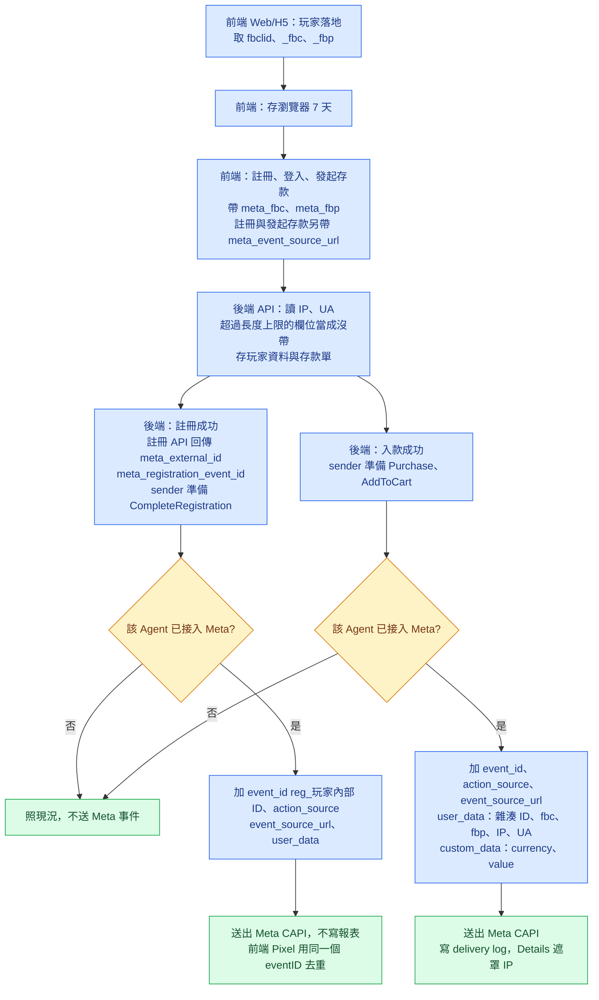

# Meta CAPI 事件加帶比對參數 — RD 開發 Spec

- 對象站點：所有已接入 Meta 的 Agent（含 BA032）
- 對象平台：Web／H5 前台、後端 API
- 涉及事件：Meta `Purchase`、`AddToCart`、`CompleteRegistration`

---

## 1. 背景與範圍

BA032 的 Meta `Purchase` 事件，Events Manager 收到的筆數與 BO 紀錄一致，Ads Manager 卻幾乎歸因不到廣告。現況事件的 `user_data` 沒有任何比對用欄位，Meta 無法把事件對回點過廣告的人。

本次做四件事：

1. 前台在玩家落地時取得 Meta 比對參數，於註冊、登入、發起存款時交給後端。
2. 後端把比對參數存到玩家資料與存款單。
3. 後端送出的 `Purchase`、`AddToCart`、`CompleteRegistration` 帶上比對參數。
4. 前台 Meta Pixel 帶上與後端相同的 `external_id`。

上線後，所有已接入 Meta 的 Agent 都套用本案。

任務分三類標示：**前端（Web/H5）**、**後端（API）**、**待技術主管指派**。

## 2. 名詞表

| 名詞 | 意思 |
|---|---|
| 已接入 Meta 的 Agent | Agent BO `System Config` 已設定 `Meta Access Token` 的 Agent |
| 比對參數 | `fbc`、`fbp`、`client_ip_address`、`client_user_agent` |
| 玩家資料 | 後端保存的玩家紀錄 |
| 存款單 | 玩家發起存款時後端建立的紀錄 |
| 雜湊 ID | 玩家內部 ID 以 SHA-256 雜湊後的小寫 16 進位字串 |
| sender | 後端送出 Meta Conversions API 事件的程式 |
| 前台網域 | 玩家使用的前台網站網域。一個 Agent 可以有多個前台網域，而且會變動 |
| PWA 網域 | 玩家安裝的 PWA 所在網域 |
| 落地 | 玩家從外部連結進入前台網域的第一個頁面 |

## 3. 適用範圍

| Agent | sender 的行為 |
|---|---|
| 已接入 Meta 的 Agent | 照第 6 節送出事件 |
| 沒有接入 Meta 的 Agent | 與現況相同，不送 Meta 事件 |

- 本案不新增設定畫面。Admin BO 與 Agent BO 的畫面都不變。
- 不論 Agent 是否已接入 Meta，前端都照第 4 節取得與送出比對參數。
- 不論 Agent 是否已接入 Meta，後端都照第 5 節保存比對參數。
- Agent 之後才接入 Meta 時，sender 送出的事件使用已保存的值。

## 4. 前端（Web/H5）：取得與送出比對參數

### 4.1 瀏覽器保存格式

前端用 `localStorage` 的一個 key 保存比對參數：

| 項目 | 內容 |
|---|---|
| key | `meta_match` |
| value | JSON 字串，格式見下方範例 |
| `value` 欄位 | 比對參數原值，字串 |
| `ts` 欄位 | 前端取得該值的時間，Unix 毫秒 |

```json
{
  "fbc": { "value": "fb.1.1793070230123.IwAR2xYz", "ts": 1793070230123 },
  "fbp": { "value": "fb.1.1793070100456.1234567890", "ts": 1793070230123 }
}
```

- 某個參數沒有值時，JSON 裡不出現該參數。
- 前端讀寫 `localStorage` 時攔截例外，頁面照常運作。
- `localStorage` 無法讀寫時，前端把比對參數存在本頁記憶體。本頁發出的 request 照 4.3 帶上這些值。
- 本頁記憶體裡的值在頁面關閉或換頁後消失。

### 4.1.1 網域範圍

- 前端不寫死前台網域。新增或更換前台網域時，前端不需要改程式。
- 前端在當下頁面的 origin 讀寫 `meta_match`。
- 前端從當下頁面的 `document.cookie` 讀取 `_fbc` cookie 與 `_fbp` cookie。
- 前端不另外讀取 PWA 網域與 tracker link 網域上的 cookie。
- 前端在前台網域讀不到 PWA 網域與 tracker link 網域上的 `localStorage`。
- 本案經由網址上的 `fbclid`，把廣告點擊從 PWA 網域帶到前台網域。轉址的要求見第 8 節。
- 轉址後網址沒有 `fbclid` 時，前端照表 A 的 A4 到 A7 處理。
- 前端的 `fbp` 照表 B 取得：來自當下頁面的 `_fbp` cookie，或保存期限內的副本。
- `localStorage` 依 origin 分開保存。
- scheme、主機名稱、port 任一項不同時，前端讀不到另一個 origin 的 `meta_match`。
- 玩家換到另一個 origin 時，前端讀取新 origin 的 `meta_match`，再照 4.2 重新決定 `fbc`、`fbp`。

### 4.2 每次載入頁面時的處理步驟

玩家每次載入前台網域的任一頁面時，前端照下列順序執行：

1. 前端讀取 `meta_match`。
2. 前端用 `URLSearchParams` 讀取目前網址的 `fbclid`。`fbclid` 是空字串時，前端當成網址沒有 `fbclid`。
3. 前端從 `document.cookie` 讀取 `_fbc` 與 `_fbp`。
4. 前端照表 A 決定 `fbc` 與它的 `ts`。
5. 前端照表 B 決定 `fbp` 與它的 `ts`。
6. 前端把結果寫回 `meta_match`。`localStorage` 無法讀寫時，前端把結果存在本頁記憶體。

表中用到的詞：

| 詞 | 意思 |
|---|---|
| 未過期 | `ts` 距今小於或等於 604,800,000 毫秒（7 天） |
| 已過期 | `ts` 距今大於 604,800,000 毫秒 |
| 尾段 | `fbc` 第三個 `.` 之後的字串 |
| 建立時間 | `fbc` 第二個 `.` 與第三個 `.` 之間的 Unix 毫秒數 |

**表 A：`fbc`**。前端由上往下比對，用第一個符合的列。

| 列 | 網址 `fbclid` | 已保存的 `fbc` | `_fbc` cookie | `fbc` 結果 | `ts` 結果 |
|---|---|---|---|---|---|
| A1 | 有 | 尾段等於 `fbclid`，未過期 | 不看 | 不改 | 不改 |
| A2 | 有 | 尾段等於 `fbclid`，已過期 | 不看 | 不改 | 設為目前時間 |
| A3 | 有 | 沒有，或尾段不等於 `fbclid` | 不看 | 設為 `fb.1.<目前 Unix 毫秒>.<fbclid>` | 設為目前時間 |
| A4 | 沒有 | 未過期 | 有值，與已保存的不同，建立時間晚於已保存的 | 設為 cookie 的值 | 設為目前時間 |
| A5 | 沒有 | 未過期 | 其他狀態 | 不改 | 不改 |
| A6 | 沒有 | 沒有，或已過期 | 有值 | 設為 cookie 的值 | 設為目前時間 |
| A7 | 沒有 | 沒有，或已過期 | 沒有值 | 刪除 | 刪除 |

**表 B：`fbp`**。前端由上往下比對，用第一個符合的列。

| 列 | `_fbp` cookie | 已保存的 `fbp` | `fbp` 結果 | `ts` 結果 |
|---|---|---|---|---|
| B1 | 有值，與已保存的相同 | 未過期 | 不改 | 不改 |
| B2 | 有值，與已保存的不同 | 未過期 | 設為 cookie 的值 | 設為目前時間 |
| B3 | 有值 | 沒有，或已過期 | 設為 cookie 的值 | 設為目前時間 |
| B4 | 沒有值 | 未過期 | 不改 | 不改 |
| B5 | 沒有值 | 沒有，或已過期 | 刪除 | 刪除 |

補充規則：

- 網址有 `fbclid` 時，表 A 不看 `_fbc` cookie。
- `fbclid` 照原樣使用，大小寫不可改動，也不可做 URL decode 以外的處理。
- 前端不自行產生 `fbp`。
- 7 天期限只管瀏覽器裡保存的值。已過期的參數，cookie 仍有值時，前端照 A6、B3 重新取得。

範例（表 A）：

| 情境 | 已保存的 `fbc` | 網址 `fbclid` | `_fbc` cookie | 結果 | 列 |
|---|---|---|---|---|---|
| 第一次點廣告進站 | 無 | `AbC1` | 無 | `fb.1.<目前毫秒>.AbC1` | A3 |
| 同一次點擊後重新整理 | `fb.1.1000.AbC1`，未過期 | `AbC1` | 無 | 維持 `fb.1.1000.AbC1` | A1 |
| 同一次點擊重新整理，cookie 較新、尾段相同 | `fb.1.1000.AbC1`，未過期 | `AbC1` | `fb.1.1500.AbC1` | 維持 `fb.1.1000.AbC1` | A1 |
| 同一次點擊重新整理，cookie 較新、尾段不同 | `fb.1.1000.AbC1`，未過期 | `AbC1` | `fb.1.1500.OtherB` | 維持 `fb.1.1000.AbC1` | A1 |
| 同一次點擊，8 天後重新整理 | `fb.1.1000.AbC1`，已過期 | `AbC1` | 無 | 維持 `fb.1.1000.AbC1`，`ts` 為目前時間 | A2 |
| 隔天點另一則廣告 | `fb.1.1000.AbC1`，未過期 | `XyZ9` | 無 | `fb.1.<目前毫秒>.XyZ9` | A3 |
| 直接輸入網址進站，cookie 較新 | `fb.1.1000.AbC1`，未過期 | 無 | `fb.1.2000.QwE5` | `fb.1.2000.QwE5` | A4 |
| 點新廣告後換頁，舊 cookie 仍在 | `fb.1.5000.NewB`，未過期 | 無 | `fb.1.2000.OldA` | 維持 `fb.1.5000.NewB` | A5 |
| 網址 `fbclid` 是空字串 | `fb.1.1000.AbC1`，未過期 | 空字串 | 無 | 維持 `fb.1.1000.AbC1` | A5 |
| 保存超過 7 天，cookie 仍在 | `fb.1.1000.AbC1`，已過期 | 無 | `fb.1.2000.QwE5` | `fb.1.2000.QwE5`，`ts` 為目前時間 | A6 |
| 保存超過 7 天，沒有 cookie | `fb.1.1000.AbC1`，已過期 | 無 | 無 | 刪除，`fbc` 無值 | A7 |

### 4.3 送給後端

下列三支 API 的 request，前端帶上瀏覽器保存的值。欄位定義見 7.1。

| 時機 | 帶的欄位 |
|---|---|
| 註冊 | `meta_fbc`、`meta_fbp`、`meta_event_source_url` |
| 登入 | `meta_fbc`、`meta_fbp` |
| 發起存款 | `meta_fbc`、`meta_fbp`、`meta_event_source_url` |

- 前端組 request 前再檢查一次 `ts`。已過期的參數，前端不帶。
- `meta_fbc` 與 `meta_fbp` 的值取自 `meta_match`（4.1）。`meta_match` 沒有某個值時，前端不帶該欄位，不送空字串。
- `meta_event_source_url` 是玩家當下所在頁面的完整網址。

### 4.4 Pixel 帶 `external_id`

- 玩家已登入時，前端初始化 Pixel 帶上 `external_id`。
- 前端不自行雜湊 `external_id`。
- 適用的 Pixel 事件：`PageView`、`CompleteRegistration`、`Lead`。
- 玩家未登入時，前端初始化 Pixel 不帶 `external_id`。
- `external_id` 的值來自登入、註冊或玩家資料 API 回傳的 `meta_external_id`（見 7.2）。

Pixel 使用者資料在同一頁內的變化：

| 情境 | 前端對 Pixel 使用者資料的動作 |
|---|---|
| 登入、註冊或玩家資料 API 回傳 `meta_external_id` | 設為該回傳的 `meta_external_id` |
| 登出 | 移除 `external_id` |
| 換成另一位玩家登入 | 設為該玩家登入回傳的 `meta_external_id` |

- 前端在送出下一個 Pixel 事件前完成上表的動作。

- 前端移除 `external_id` 後，之後的 Pixel 事件不帶 `external_id`。
- 更新 Pixel 使用者資料的寫法，由前端 RD 依現有 Pixel 安裝方式決定。

### 4.5 Pixel `CompleteRegistration` 去重

註冊成功時，前端照下列順序執行：

1. 前端用註冊 API 回傳的 `meta_external_id` 更新 Pixel 的使用者資料。
2. 前端送 Pixel `CompleteRegistration`，`eventID` 用註冊 API 回傳的 `meta_registration_event_id`。

- 前端只送一次 Pixel `CompleteRegistration`。
- 後端的 `CompleteRegistration` 使用同一個 `event_id`，Meta 以此去重。

## 5. 後端（API）：保存比對參數

### 5.1 IP 與 UA

- 後端從 request 讀取玩家的 IP 與 User-Agent。
- 前端不送 IP 與 User-Agent。

### 5.2 玩家資料

註冊成功與登入成功時，後端更新玩家資料：

| 欄位 | 型別 | 來源 | 更新規則 |
|---|---|---|---|
| `fbc` | `VARCHAR(500)` | request 的 `meta_fbc` | request 有值時覆蓋；沒有值時保留舊值 |
| `fbp` | `VARCHAR(255)` | request 的 `meta_fbp` | request 有值時覆蓋；沒有值時保留舊值 |
| `client_ip_address` | `VARCHAR(45)` | request 的 IP | 每次覆蓋 |
| `client_user_agent` | `TEXT` | request 的 User-Agent | 每次覆蓋 |

### 5.3 存款單

發起存款時，後端在存款單記下：

| 欄位 | 型別 | 來源 |
|---|---|---|
| `fbc` | `VARCHAR(500)` | request 的 `meta_fbc` |
| `fbp` | `VARCHAR(255)` | request 的 `meta_fbp` |
| `client_ip_address` | `VARCHAR(45)` | request 的 IP |
| `client_user_agent` | `TEXT` | request 的 User-Agent |
| `event_source_url` | `VARCHAR(2048)` | request 的 `meta_event_source_url` |

request 沒有某個值時，存款單的該欄位為 NULL。

欄位名稱由後端 RD 依既有命名決定；型別照上表。

### 5.4 雜湊 ID

- 後端以玩家內部 ID 的字串形式計算 SHA-256，輸出小寫 16 進位字串。
- 後端在 sender 與玩家資料 API 使用同一個計算方式。

## 6. 後端（API）：sender 送出的事件

### 6.1 適用條件

- Agent 已接入 Meta 時，sender 照本節組 Web／H5 發起的事件。
- App 發起的事件維持現況。
- Agent 沒有接入 Meta 時，sender 照現況不送 Meta 事件。

### 6.2 `Purchase` 與 `AddToCart`

既有觸發時機不變：首次入款成功送 `Purchase`，入款成功送 `AddToCart`。

| 欄位 | 值 | 取值順序 |
|---|---|---|
| `event_id` | `Purchase`：`ftd_<存款單號>`；`AddToCart`：`dep_<存款單號>` | — |
| `action_source` | `website` | — |
| `event_source_url` | 存款單的 `event_source_url` | 只取存款單 |
| `user_data.external_id` | 雜湊 ID | — |
| `user_data.fbc` | 存款單的 `fbc` | 存款單 → 玩家資料 |
| `user_data.fbp` | 存款單的 `fbp` | 存款單 → 玩家資料 |
| `user_data.client_ip_address` | 存款單的值 | 存款單 → 玩家資料 |
| `user_data.client_user_agent` | 存款單的值 | 存款單 → 玩家資料 |
| `custom_data.currency` | 存款幣別，ISO 4217 大寫 | — |
| `custom_data.value` | 入款金額，JSON 數字 | — |

- 取值順序「存款單 → 玩家資料」：存款單有值時用存款單；存款單沒有值時用玩家資料。
- 兩處都沒有值時，sender 不帶該欄位，事件照送。
- `event_source_url` 或 `client_user_agent` 沒有值時，sender 也照送。現況事件沒有這兩個欄位，Events Manager 仍照常收到。
- sender 送出事件時，不雜湊 `fbc`、`fbp`、`client_ip_address`、`client_user_agent`。
- sender 把 `DECIMAL(18,2)` 的入款金額轉成 JSON 數字，放進 `custom_data.value`。轉換過程不可使用 float。
- sender 照現況送出既有自訂參數 `Username`、`Amount`、`Currency`、`Date`。

### 6.3 `CompleteRegistration`

註冊成功時，sender 送 `CompleteRegistration`：

| 欄位 | 值 |
|---|---|
| `event_id` | `reg_<玩家內部 ID>` |
| `action_source` | `website` |
| `event_source_url` | 註冊 request 的 `meta_event_source_url` |
| `user_data.external_id` | 雜湊 ID |
| `user_data.fbc` | 註冊 request 的 `meta_fbc` |
| `user_data.fbp` | 註冊 request 的 `meta_fbp` |
| `user_data.client_ip_address` | 註冊 request 的 IP |
| `user_data.client_user_agent` | 註冊 request 的 User-Agent |

- 註冊 request 沒有某個值時，sender 不帶該欄位，事件照送。
- 註冊 request 的值超過長度上限時，sender 不帶該欄位（見 7.1）。
- 後端不把 `CompleteRegistration` 寫進 `Marketing Event Delivery Report`。

### 6.4 `Marketing Event Delivery Report` 的 Details

- `Purchase`、`AddToCart` 的 request properties 顯示該事件送出的新增欄位：`event_id`、`action_source`、`event_source_url`、`user_data` 各欄、`currency`、`value`。
- sender 沒有帶的欄位，Details 不顯示。
- Details 把 `external_id` 顯示為雜湊 ID。
- Details 把 `fbc`、`fbp`、`client_user_agent`、`event_source_url` 顯示為原值。
- 後端把 `client_ip_address` 加進遮罩清單。Details 把 `client_ip_address` 顯示為 `***`。

## 7. 前後端介面

### 7.1 前端送給後端的 request 欄位

| 欄位 | 型別 | 必填 | 註冊 | 登入 | 發起存款 |
|---|---|---|---|---|---|
| `meta_fbc` | string，長度上限 500 | 否 | 帶 | 帶 | 帶 |
| `meta_fbp` | string，長度上限 255 | 否 | 帶 | 帶 | 帶 |
| `meta_event_source_url` | string，長度上限 2048 | 否 | 帶 | 不帶 | 帶 |

- 欄位缺少時，後端照常處理註冊、登入、存款，不回錯誤。
- 後端處理 request 時，先檢查各欄位長度。
- 欄位超過長度上限時，後端把該欄位當成這次 request 沒有帶。
- 欄位超過長度上限時，後端不保存該欄位的值。
- 欄位超過長度上限時，sender 不使用該欄位的值。
- 欄位超過長度上限時，後端照常處理註冊、登入、存款，不回錯誤。
- 長度剛好等於上限時，後端照常保存。

### 7.2 後端回給前端的 response 欄位

| API | 欄位 | 型別 | 說明 |
|---|---|---|---|
| 玩家資料 | `meta_external_id` | string | 雜湊 ID。一律回傳 |
| 登入成功 | `meta_external_id` | string | 雜湊 ID。一律回傳 |
| 註冊成功 | `meta_external_id` | string | 雜湊 ID。一律回傳 |
| 註冊成功 | `meta_registration_event_id` | string | `reg_<玩家內部 ID>`。一律回傳 |

- 不論 Agent 是否已接入 Meta，後端都回傳上表欄位。

## 8. 待技術主管指派

| 項目 | 要求 |
|---|---|
| tracker link 轉址 | 玩家經 PWA 網域 → tracker link → 前台網域時，負責轉址的服務在每一次轉址都保留網址上的 `fbclid`，不改動其值 |

## 9. 範圍外

- 不處理 App（iOS／Android）發起的事件。
- 不送 `em`、`ph`。
- 不移除既有的明文 `Username` 自訂參數。
- 不補送本次上線前已送出的事件。
- 不改動 Adjust、CleverTap 事件。
- `CompleteRegistration` 不加進 `Marketing Event Delivery Report`。
- 不處理 Meta 後台設定，包括 dataset、ad set 與網域驗證。
- 驗收只核對事件 payload，不核對 Ads Manager 的歸因成效。

## 10. 流程圖


